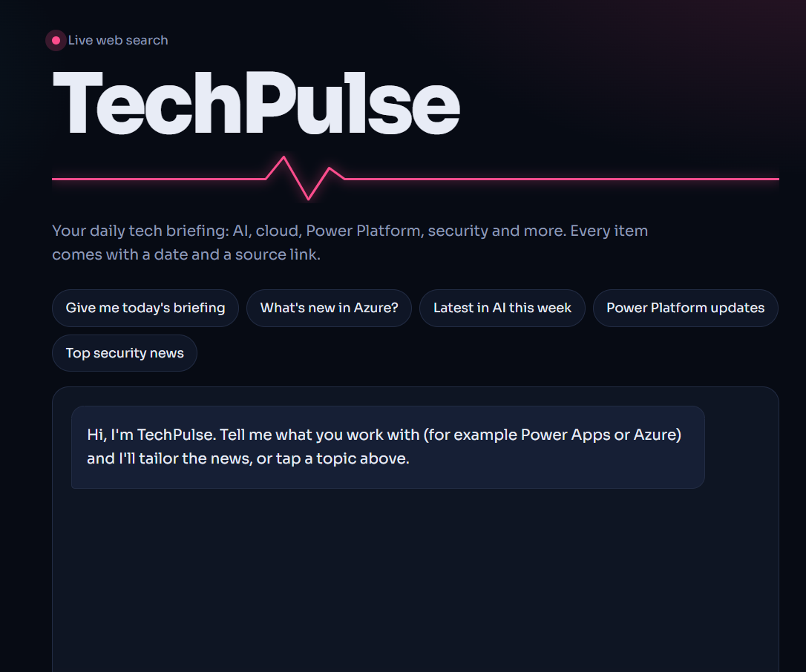
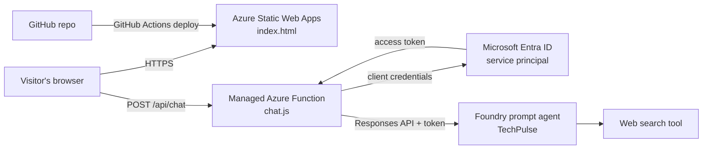

# TechPulse: an AI tech-news assistant on Azure

**Live site:** https://icy-ocean-02acab203.3.azurestaticapps.net/ &nbsp;|&nbsp; **Built by:** YOUR NAME ([LinkedIn](www.linkedin.com/in/sibonginhlanhla-magwaza-ab662b282))

TechPulse is a single-page web app where visitors get a live tech briefing (AI, cloud, Power Platform, security) with dated items and source links. The answers come from an AI agent in Microsoft Foundry that searches the web before it responds.

I built it to practise core Azure skills after passing AZ-900: hosting, serverless APIs, identity, access control and cost control.

<!-- Add a screenshot at docs/screenshot.png -->

## Architecture

| Piece | Azure service | Purpose |
|---|---|---|
| Front end | Static Web Apps (Free plan) | Hosts the page, HTTPS, custom domain |
| API | Managed Functions (Node 20) | Hides credentials, adds rate limits |
| Identity | Microsoft Entra ID service principal | Lets the Function call the agent without exposing keys |
| Access | Azure RBAC (Foundry User role) | Least privilege: the principal can call the agent and nothing else |
| AI | Microsoft Foundry prompt agent + web search | Writes the briefings and cites sources |
| Delivery | GitHub Actions | Deploys on every push |

## Security and cost decisions

- Secrets live only in Static Web App environment variables, never in the repo.
- The browser never sees a token. It only talks to `/api/chat`.
- The service principal has one role on one project (least privilege).
- The API limits each visitor to 5 messages a minute and 20 an hour, trims inputs to 600 characters and sends only the last 6 messages.
- A budget alert and a model quota cap spending, since web search is billed per call.

## Run or deploy it yourself

1. Create a Foundry project, deploy a model, and create a prompt agent with web search.
2. Create a service principal and give it the **Foundry User** role on the project.
3. Create a Static Web App (Free plan) from this repo: app location `/`, API location `api`, no output location.
4. Add these environment variables: `PROJECT_ENDPOINT`, `AGENT_NAME`, `AZ_TENANT_ID`, `AZ_CLIENT_ID`, `AZ_CLIENT_SECRET`.

## Next steps

- [ ] Rebuild the environment with Bicep (infrastructure as code)
- [ ] Add Application Insights monitoring and an alert
- [ ] Replace the client secret with a managed identity setup
